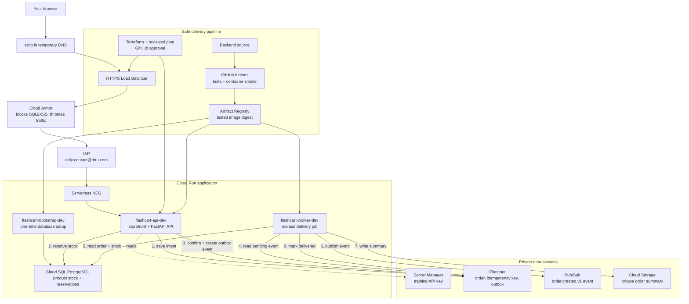

# FlashCart dev infrastructure

A reusable GCP training project. Follow one complete order from a private API
through PostgreSQL inventory, Firestore orders, Pub/Sub events and a private
stored order summary. Start with [the practical training guide](docs/TRAINING.md).

## Current delivery

- Existing foundation: `flashcart-dev` VPC/subnet, private Cloud SQL PostgreSQL
  inventory instance/database, Firestore default database, Pub/Sub and invoices bucket.
- Artifact Registry `flashcart-docker`: created and verified by approved
  [run 42996975357](https://github.com/binnukyadari/flashcart-gcp-infra/actions/runs/42996975357).
- Backend/frontend: deployed and verified by [run 43050291973](https://github.com/binnukyadari/flashcart-gcp-infra/actions/runs/43050291973).
  The tested image passed 39 tests. Live verification confirmed order creation,
  idempotent replay, one stock deduction, worker delivery, a Pub/Sub event and a
  private GCS summary.
- `stacks/05-edge`: HTTPS load balancer, temporary DNS hostname, managed TLS,
  Cloud Armor WAF/rate limiting and IAP access for `contact@ritru.com`.
  See [edge setup and verification](docs/EDGE.md) for current readiness.
- No staging/prod changes are part of this training delivery.

## Final architecture



How to read it: the **top line** is what protects and serves the browser, the
**middle** is what happens during an order, and the **bottom** is how tested code
reaches Cloud Run. An order is confirmed after stock is reserved. It reaches
Pub/Sub and Cloud Storage only when you manually run the worker. There are no
payments or shipping.

The edge is the intended browser entry point. IAP authenticates the trainer;
Cloud Armor filters requests; the application API key remains required for API
calls. Cloud Run IAM has no `allUsers` grant. The original authenticated proxy
remains an administrative access path outside Cloud Armor until ingress
hardening is separately reviewed.

## Read the stacks in order

| Path | Responsibility |
| --- | --- |
| `stacks/01-network`, `modules/vpc-network` | Existing VPC, Cloud Run subnet, private service access, NAT and IAP firewall |
| `stacks/02-data`, `modules/data-tier` | Existing SQL, Firestore, legacy Pub/Sub and invoice bucket |
| `stacks/03-application`, `modules/application-tier` | Immutable-tag Docker repository |
| `stacks/05-edge` | HTTPS edge, TLS, Cloud Armor and trainer-only IAP |
| `stacks/04-backend` | Private API, bootstrap/worker jobs, runtime identities, secrets and compatible events |

The backend stack preserves the earlier stacks and the legacy event topic/schema.
It creates a separate event topic matching the backend's actual event envelope.

## GitHub workflows

| File | Purpose |
| --- | --- |
| `infra.yml` | Original registry PR checks plus local safety tests |
| `terraform-stack.yml` | Reusable read-only registry plan |
| `deploy-dev.yml` | Original main-only, approval-gated registry creation |
| `backend-dev.yml` | Read-only backend PR plan, then approved main-only deployment |
| `drift.yml` | Paused; manual placeholder only |

There are no push-triggered deployments. Both apply switches default off and
manual inputs default to plan-only. Deployment requires the exact confirmation,
a reviewed source/plan and required GitHub environment approval. Expired plans,
changed main or changed plan fingerprints stop the run. Raw plans/state are not
uploaded. Read-only plans use local snapshots because initializing a new GCS
backend writes state/lock objects. Apply uses the real remote backend and locking.

## State and credentials

- Dev project: `ritru-fc-dev-01`; region: `asia-south1`.
- State bucket: `ritru-tfstate-586582398977`; prefix: `gcp-02-flashcart`.
- Separate state paths for every stack/environment; the backend uses
  `gcp-02-flashcart/stacks/04-backend/dev`.
- WIF provides temporary credentials. No service-account JSON keys are needed.
- The read-only plan account reads only the permitted dev state objects and has
  no deployment writes. Runtime identities have separate app permissions.
- `TF_BACKEND_API_KEY` and `TF_BACKEND_BOOTSTRAP_PASSWORD` are protected GitHub
  secrets. Terraform stores their deployed values in Secret Manager. Private
  Terraform state/saved plans also contain sensitive values; never commit,
  publish or paste them into chat or screenshots.
- GitHub now uses immutable OIDC subjects containing numeric account/repository
  IDs. Trust conditions must use the actual configured subject, including the
  environment name for approval-gated jobs.

The original registry history and gate details are in
[DEV-DEPLOYMENT.md](docs/DEV-DEPLOYMENT.md). That document records the earlier
preparation boundary; use actual Actions/settings for current gate status.

## Validate locally without cloud access

```bash
terraform fmt -check -recursive stacks/04-backend
terraform -chdir=stacks/04-backend init -backend=false
terraform -chdir=stacks/04-backend validate
python3 -m unittest discover -s tests -v
```

Use disposable local databases/emulators for backend tests. Never run their
TRUNCATE-based integration fixtures against shared or GCP data. The live demo
bootstrap is different: it creates missing schema, grants runtime table access
and inserts the demo product without resetting existing stock or orders.
